

  

  
  
  
  
  
  

  <b><a href="https://github.com/cr0ssn0tice/LoxBerry-Plugin-ochsner2mqtt/releases/latest">Download</a></b> ·
  <a href="docs/installation.md">Installation</a> ·
  <a href="docs/bedienung.md">Bedienung</a> ·
  <a href="docs/loxone.md">Loxone</a> ·
  <a href="docs/mqtt-referenz.md">MQTT-Referenz</a> ·
  <a href="docs/fehlersuche.md">Hilfe</a> ·
  <a href="#english">English</a>

---

**Ochsner OTS** holt deine Ochsner-Wärmepumpe auf den LoxBerry: Der LoxBerry liest den Regler (Siemens Climatix,
Ochsner Touch System) **lokal** im Heimnetz aus, zeigt die Anlage als **App** mit lebendem Anlagenschema, lässt sie
dort **bedienen** und gibt alle Werte per **MQTT an den Loxone Miniserver** weiter. Ohne Cloud, ohne Zusatz-Hardware,
mit eingebautem Schutz für den Flash-Speicher des Reglers.

  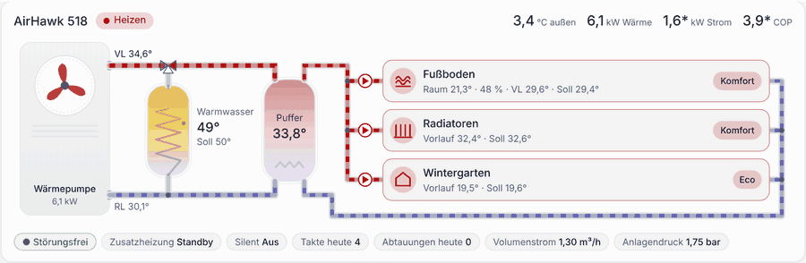 
  Anlagenschema mit Fließanimation – sie läuft nur, solange wirklich Wasser fließt.

## Highlights

<table>
<tr>
<td width="50%" valign="top">

### 🏠 Die App
- **Lebendes Anlagenschema:** Außeneinheit, Warmwasser, Puffer, alle Heizkreise – Vor- und Rücklauf animiert
- **Bedienen wie in der Ochsner-App:** Auto/Aus, Komfort/Eco/Aus, Raumsoll, Warmwasser-Soll und Boost
- **Zeitprogramm** im Wochenraster, **Heizkurve** zum Ziehen
- **Energie der letzten 24 h:** Wärme, Strom, COP, Takte, Laufzeit, JAZ
- Hell und dunkel, Desktop und Handy, Deutsch und Englisch

</td>
<td width="50%" valign="top">

### 🔗 Loxone und MQTT
- **Alle Anlagenwerte** als MQTT-Topics, Namen der virtuellen Eingänge zum Kopieren
- **Befehle** per virtuellem Ausgang: Betriebsart, Sollwerte, Warmwasser-Boost
- **MQTT Gateway V1 und V2** – bei V2 Topics mit einem Klick eintragen
- Störungen als Topic und als **LoxBerry-Benachrichtigung**
- Rohwerte aller Katalogpunkte für Node-RED & Co.

</td>
</tr>
<tr>
<td width="50%" valign="top">

### 🛡️ Schutz des Reglers
- Schreiben ab Werk **gesperrt**
- Nur echte Änderungen, vorher frisch gelesen
- Grenzen, **Tageslimit**, Mindestabstand für Automationen
- **Flash-Zähler** und Schreibprotokoll
- Zugangsdaten bleiben auf dem LoxBerry, Diagnose-Export ohne Geheimnisse

</td>
<td width="50%" valign="top">

### 🧩 Sauber im LoxBerry
- LoxBerry Design System, Navigation, Hilfe-Panel
- Protokoll im **Log Manager**, Protokollstufe ohne Neustart
- **Healthcheck**, Benachrichtigungen, automatische Updates
- Deinstallation räumt am Broker und im Gateway auf
- Umgesetzt nach dem LoxBerry-Entwickler-Wiki

</td>
</tr>
</table>

## Screenshots

<table>
<tr>
<td colspan="2">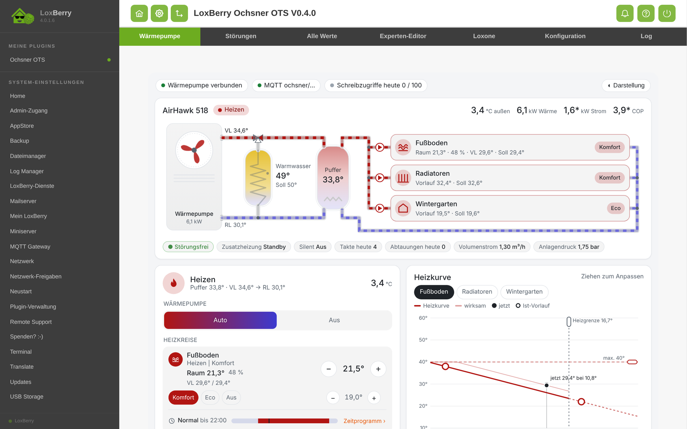 <b>Wärmepumpe</b> – die App im LoxBerry</td>
</tr>
<tr>
<td width="50%">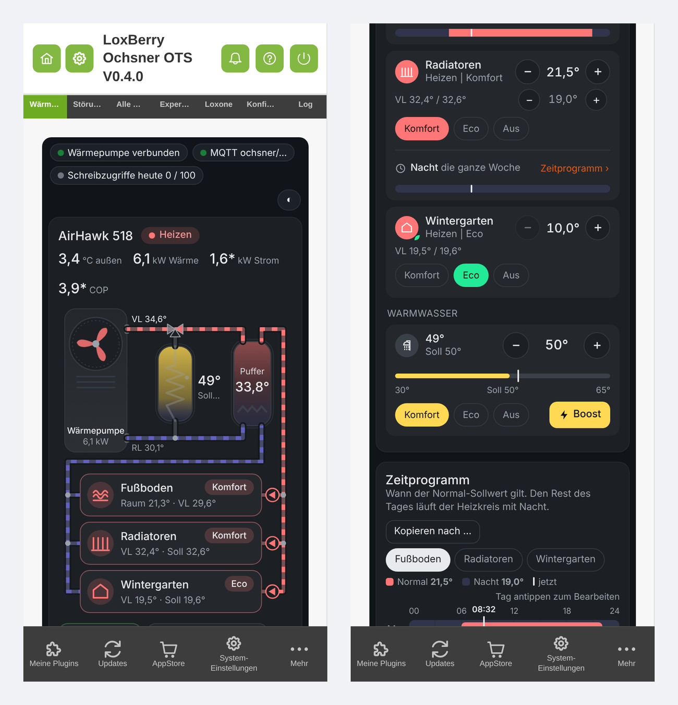 Am Handy, dunkle Darstellung</td>
<td width="50%">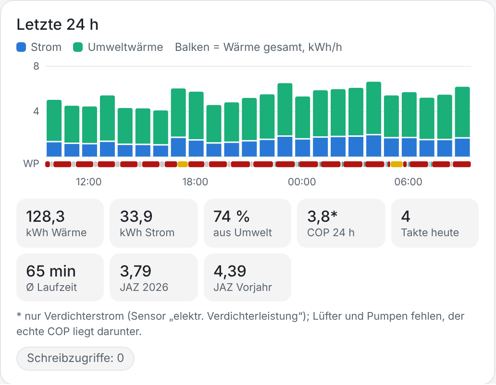 Letzte 24 h: Wärme, Strom, COP, Takte, JAZ</td>
</tr>
<tr>
<td width="50%">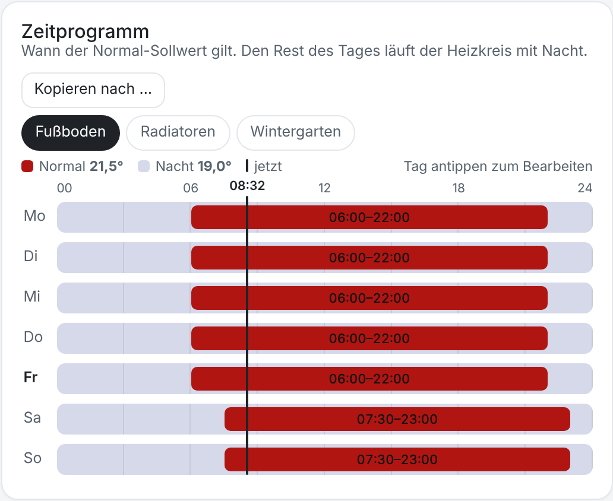 Zeitprogramm – schreibt nur geänderte Schaltpunkte</td>
<td width="50%">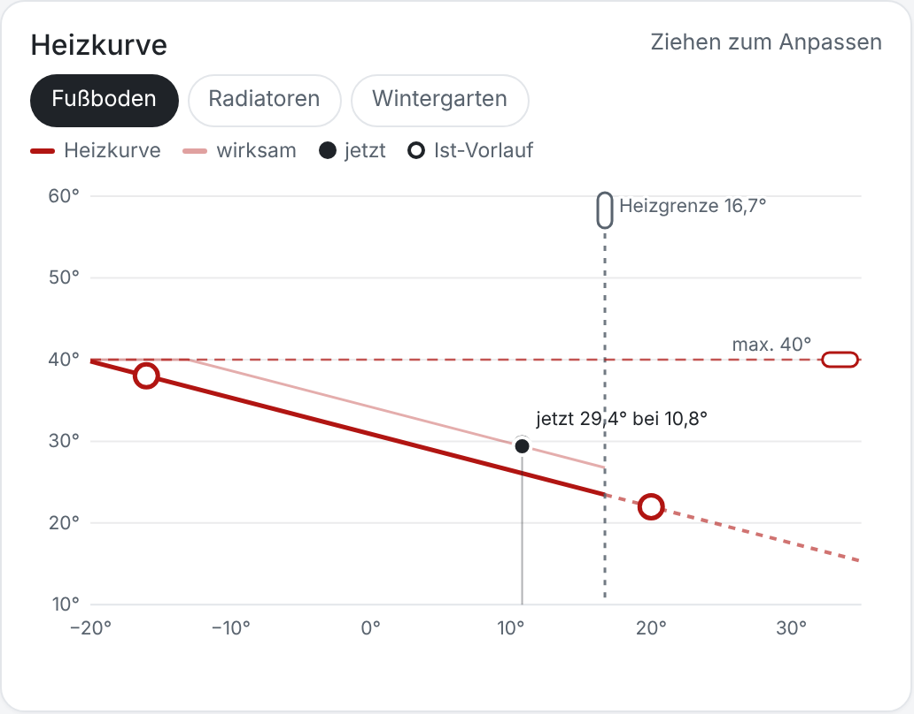 Heizkurve mit Arbeitspunkt, zum Ziehen</td>
</tr>
<tr>
<td width="50%">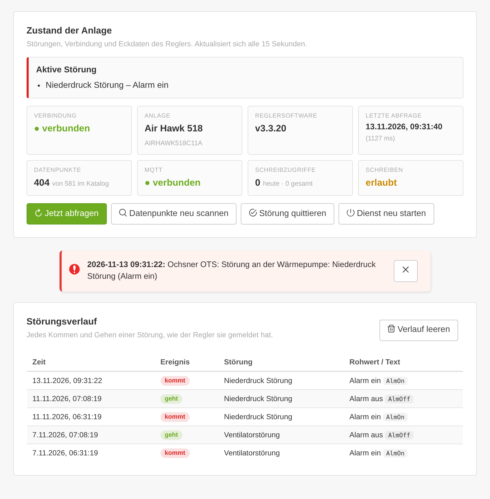 <b>Störungen</b> – Zustand, Benachrichtigungen, Verlauf</td>
<td width="50%">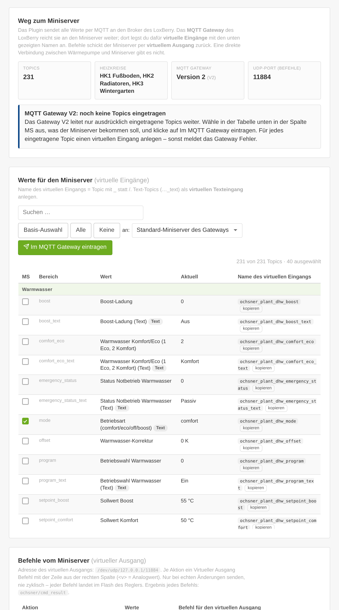 <b>Loxone</b> – virtuelle Eingänge und Befehle zum Kopieren</td>
</tr>
<tr>
<td width="50%">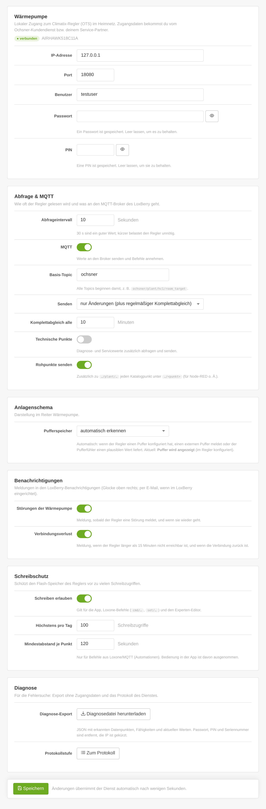 <b>Konfiguration</b> im LoxBerry-Design</td>
<td width="50%">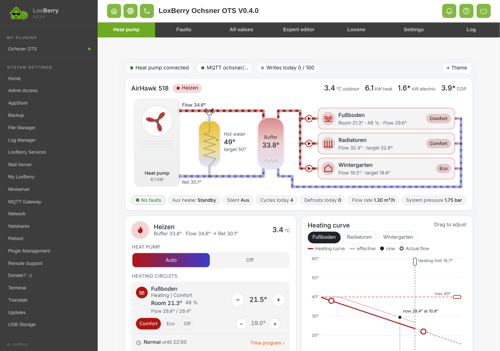 Automatisch in der Sprache des LoxBerry</td>
</tr>
</table>

Die Bilder zeigen die Testumgebung mit einer simulierten Air Hawk 518 (drei Heizkreise, Warmwasser, Puffer).
Weitere Ansichten: <a href="docs/bedienung.md">Bedienung</a>.

## So funktioniert's

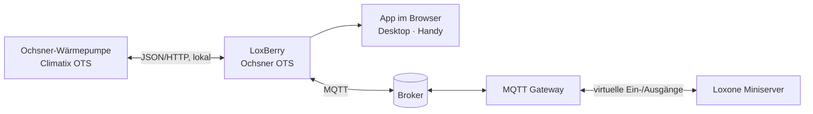

Das Plugin fragt den Regler zyklisch ab (Standard alle 30 s), deutet die Werte mit dem Datenpunkt-Katalog der
Home-Assistant-Integration [OTS-HomeAssistant](https://github.com/permissionBRICK/OTS-HomeAssistant) und
veröffentlicht sie unter `ochsner/…`. Befehle aus Loxone oder der App schreibt es mit denselben Abläufen wie die
Ochsner-App – geschützt durch Schreibsperre, Grenzen und Limits.

## Voraussetzungen

| | |
|---|---|
| **LoxBerry** | 4.0.1 oder neuer |
| **MQTT** | Plugin *MQTT Gateway* (V1 oder V2) eingerichtet |
| **Wärmepumpe** | Ochsner mit OTS-Regelung (Siemens Climatix), im Netz des LoxBerry erreichbar |
| **Zugangsdaten** | Benutzer, Passwort und PIN der lokalen Regler-Schnittstelle – vom Ochsner-Kundendienst bzw. Service-Partner |

Getestet an einer **Air Hawk 208**; der Katalog deckt weitere OTS-Anlagen ab. Rückmeldungen zu anderen Modellen
sind willkommen.

## Schnellstart

1. **ZIP herunterladen:** [Releases](https://github.com/cr0ssn0tice/LoxBerry-Plugin-ochsner2mqtt/releases/latest)
   → `LoxBerry-Plugin-ochsner2mqtt-<version>.zip`
2. **Installieren:** LoxBerry → *Plugin-Verwaltung* → ZIP auswählen → *Installieren*.
3. **Einrichten:** *Ochsner OTS → Konfiguration* → IP-Adresse, Benutzer, Passwort, PIN → *Speichern*.
   Nach wenigen Sekunden steht oben **verbunden**.
4. **Bedienen** (optional): *Konfiguration → Schreibschutz → Schreiben erlauben*.
5. **Loxone:** Reiter *Loxone* – Namen der virtuellen Eingänge kopieren, bei Gateway V2 Topics eintragen.

> [!NOTE]
> **Umstieg von 0.3:** Neue Plugin-ID ab 0.4. Die Installation bricht beim ersten Versuch bewusst ab und sichert
> alles; alte Version deinstallieren, 0.4 erneut installieren – fertig.
> [Details](docs/installation.md#umstieg-von-version-03)

## Loxone in drei Schritten

| | |
|---|---|
| **1. Werte holen** | Virtueller Eingang `ochsner_plant_hp_outdoor` ← Topic `ochsner/plant/hp/outdoor`. Text-Topics (`…_text`) als *virtuellen Texteingang*. |
| **2. Befehle senden** | Virtueller Ausgang `/dev/udp/<loxberry>/11884`, Befehl z. B. `publish ochsner/cmd/hc1/preset eco` oder `publish ochsner/cmd/hc1/room_target <v>` |
| **3. Ergebnis prüfen** | `ochsner/cmd_result` meldet jeden Befehl als JSON zurück (`ok`, `message`). |

Die wichtigsten Topics:

| Topic | Inhalt |
|---|---|
| `ochsner/plant/hp/…` | Wärmepumpe: `outdoor`, `flow`, `return`, `buffer_top`, `heat_output`, `el_power`, `cop`, `status_text`, `program_text`, … |
| `ochsner/plant/hc<n>/…` | Heizkreis: `room_target`, `room_temp`, `humidity`, `preset`, `mode`, `flow_actual`, `flow_target`, `heating`, … |
| `ochsner/plant/dhw/…` | Warmwasser: `temp`, `target_active`, `mode`, `boost`, … |
| `ochsner/alarm/count` · `alarm/active` | Anzahl und Text der aktiven Störungen |
| `ochsner/connected` · `status` | Regler erreichbar (1/0), Dienst online/offline |

Alles Weitere: **[Loxone-Anbindung](docs/loxone.md)** · **[MQTT-Referenz](docs/mqtt-referenz.md)** (alle Topics und Befehle)

> [!WARNING]
> Jeder Schreibzugriff landet im Flash-Speicher des Reglers. Aus Loxone **nie zyklisch** schreiben – nur bei echten
> Änderungen. Das Plugin bremst zusätzlich mit Mindestabstand und Tageslimit.

## Dokumentation

| | |
|---|---|
| 📦 [Installation und Einrichtung](docs/installation.md) | Voraussetzungen, alle Einstellungen, Updates, Umstieg, Deinstallation |
| 🖥️ [Bedienung](docs/bedienung.md) | App, Anlagenschema, Zeitprogramm, Heizkurve, Energie, alle Reiter |
| 🔗 [Loxone-Anbindung](docs/loxone.md) | Gateway V1/V2, virtuelle Ein- und Ausgänge, Beispiele |
| 📋 [MQTT-Referenz](docs/mqtt-referenz.md) | Alle Topics und Befehle |
| 🛡️ [Sicherheit](docs/sicherheit.md) | Schutz des Reglers, Zugangsdaten, Netz-Empfehlungen |
| 🩺 [Fehlersuche und FAQ](docs/fehlersuche.md) | Healthcheck, Log, Diagnose-Export, häufige Fragen |
| 🛠️ [Entwicklung](docs/entwicklung.md) | Aufbau, LoxBerry-Vorgaben, Tests, Release |
| 📝 [Änderungen](CHANGELOG.md) | Was neu ist |

## Mitmachen

Fehler, Ideen und Rückmeldungen zu weiteren Ochsner-Anlagen bitte als
[Issue](https://github.com/cr0ssn0tice/LoxBerry-Plugin-ochsner2mqtt/issues/new/choose) – am besten mit dem
**Diagnose-Export** aus der Konfiguration (enthält keine Zugangsdaten). Pull Requests sind willkommen, siehe
[CONTRIBUTING.md](CONTRIBUTING.md). Sicherheitsprobleme bitte vertraulich melden: [SECURITY.md](SECURITY.md).

## Dank und Lizenz

Datenpunkt-Katalog, Anlagenrollen, Schreibabläufe und das Dashboard stammen aus der hervorragenden
Home-Assistant-Integration **[permissionBRICK/OTS-HomeAssistant](https://github.com/permissionBRICK/OTS-HomeAssistant)**
(MIT). Dieses Plugin bringt sie auf den LoxBerry und zum Loxone Miniserver.

Lizenz: [MIT](LICENSE). Das Projekt ist **inoffiziell** und hat keine Verbindung zu Ochsner oder Siemens; alle
Marken gehören ihren Inhabern. Schreibzugriffe auf den Regler erfolgen auf eigene Verantwortung.

---

## English

**Ochsner OTS for LoxBerry** reads Ochsner heat pumps with OTS control (Siemens Climatix) **locally** – no cloud –,
shows them as an **app** with a live plant diagram, lets you **operate** them (modes, setpoints, hot-water boost,
time programs, heating curve) and forwards **all plant values via MQTT** to the **Loxone Miniserver** (MQTT Gateway V1/V2).
Writes to the controller are locked by default and protected by fresh reads, limits, a daily cap and a flash
counter. The user interface follows the LoxBerry language (German/English), uses the LoxBerry design system,
logs to the LoxBerry Log Manager, sends LoxBerry notifications on heat-pump faults and ships a healthcheck.

**Install:** download `LoxBerry-Plugin-ochsner2mqtt-<version>.zip` from
[Releases](https://github.com/cr0ssn0tice/LoxBerry-Plugin-ochsner2mqtt/releases/latest) → LoxBerry *Plugin
management* → install → *Ochsner OTS → Settings*: IP, user, password and PIN of the controller (from Ochsner
service). Requires LoxBerry 4.0.1+. The detailed documentation is in German; feel free to open issues in English.
