# Bedienung

[← Übersicht](../README.md) · [Installation](installation.md) · **Bedienung** · [Loxone](loxone.md) · [MQTT-Referenz](mqtt-referenz.md) · [Sicherheit](sicherheit.md) · [Fehlersuche](fehlersuche.md) · [Entwicklung](entwicklung.md)

---

Das Plugin hat sieben Reiter. **Wärmepumpe** ist die App für den Alltag, die übrigen sind für Überblick,
Loxone-Anbindung und Einrichtung. Alle Seiten folgen dem LoxBerry-Design, laufen am Handy und zeigen sich in der
Sprache des LoxBerry (Deutsch oder Englisch).

> Die Bilder stammen aus der Testumgebung mit einer simulierten Air Hawk 518 (drei Heizkreise, Warmwasser, Puffer).

## Inhalt
- [Wärmepumpe (App)](#wärmepumpe-app)
  - [Anlagenschema](#anlagenschema) · [Bedienung](#bedienung-1) · [Zeitprogramm](#zeitprogramm) ·
    [Heizkurve](#heizkurve) · [Letzte 24 h](#letzte-24-h) · [Details](#details-und-darstellung)
- [Störungen](#störungen)
- [Alle Werte](#alle-werte)
- [Experten-Editor](#experten-editor)
- [Loxone](#loxone)
- [Konfiguration](#konfiguration)
- [Log](#log)

## Wärmepumpe (App)

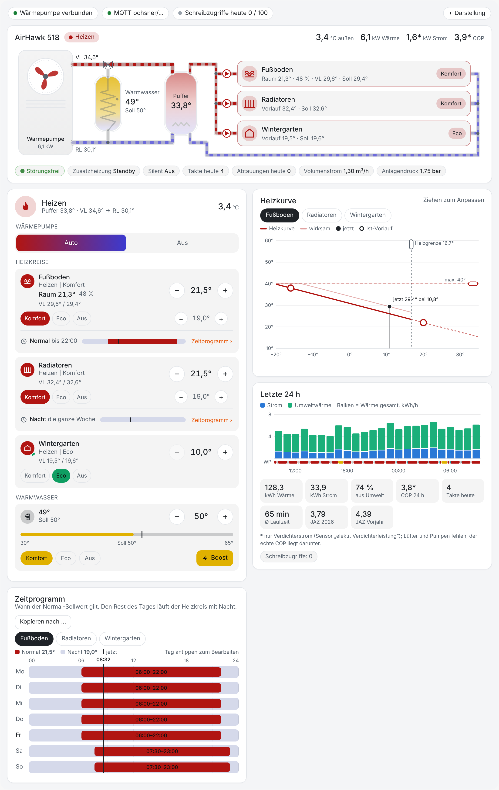

Die Statusleiste oben zeigt, ob die Wärmepumpe und MQTT verbunden sind und wie viele Schreibzugriffe heute
schon verbraucht sind (gegen das Tageslimit). Ist das Schreiben gesperrt, steht dort **Bedienung gesperrt** –
ein Klick führt zur Konfiguration. Rechts schaltet **Darstellung** zwischen hell und dunkel; die Wahl merkt sich
der Browser.

### Anlagenschema

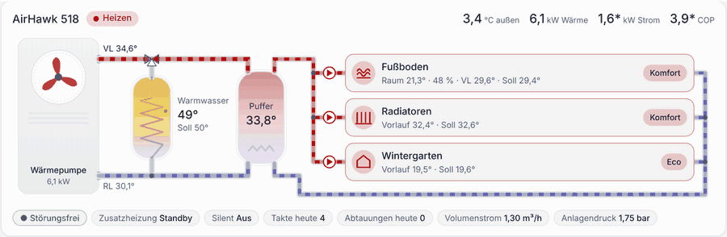

- **Außeneinheit** mit Lüfter, **Umschaltventil**, **Warmwasserspeicher** mit Heizwendel, **Pufferspeicher**
  und alle **Heizkreise** mit Umwälzpumpen – als geschlossene Kreise: Vorlauf oben (rot), Rücklauf unten (blau).
- Die **Fließanimation** läuft synchron über alle Leitungen und nur, solange wirklich Wasser fließt: beim Heizen,
  Kühlen, Abtauen und bei der Warmwasserladung (dann durch die Wendel). Mit Puffer laufen die Heizkreise während
  der Warmwasserladung weiter.
- Kopfzeile: Betriebszustand, Außentemperatur, Wärmeleistung, Strom und COP.
  Mit \* markierte Werte beruhen nur auf der Verdichterleistung; Lüfter und Pumpen fehlen, der echte COP liegt
  etwas darunter.
- Darunter: Störungsstatus, Zusatzheizung, Silent-Modus, Takte und Abtauungen heute, Volumenstrom, Anlagendruck.
- Der **Pufferspeicher** erscheint, wenn der Regler ihn konfiguriert hat, einen externen Puffer meldet oder der
  Pufferfühler plausible Werte liefert. Unter *Konfiguration → Anlagenschema* lässt er sich fest ein- oder
  ausblenden.
- Ein Klick auf einen Heizkreis öffnet seine Details.

### Bedienung

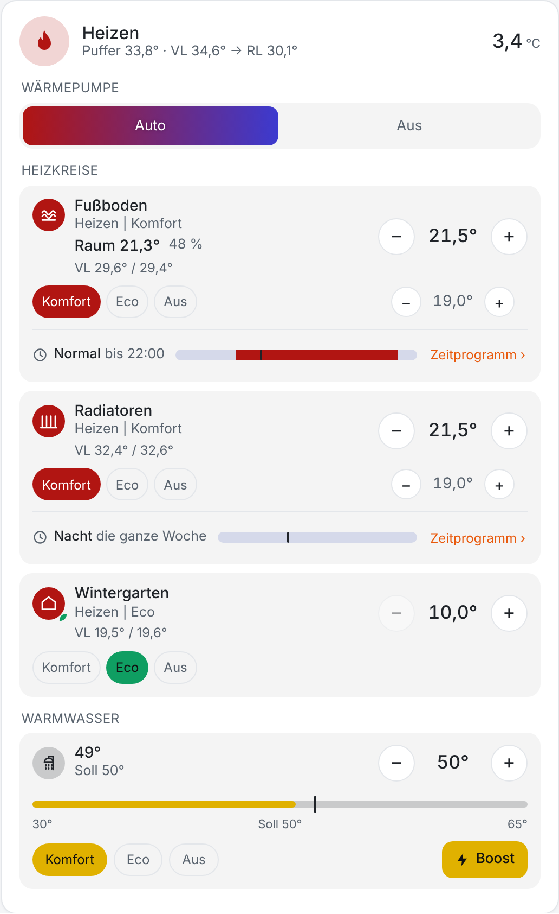

- **Wärmepumpe:** Auto oder Aus. Das Abschalten braucht einen zweiten Klick zur Bestätigung.
- **Je Heizkreis:** Komfort, Eco oder Aus, das Raumsoll über **−/+** (wie die Ochsner-App über die
  ±3-K-Korrektur) und der Nacht-/Eco-Sollwert. Darunter läuft das Zeitprogramm des Tages mit
  „Normal bis 22:00“.
- **Warmwasser:** Komfort, Eco oder Aus, Soll über −/+ und **Boost** für eine einmalige Ladung.

Mehrere Klicks auf −/+ fasst das Plugin zu einem einzigen Schreibzugriff zusammen. Vor jedem Schreiben liest es
den aktuellen Wert neu; ist er schon richtig, wird nichts geschrieben.

 

### Zeitprogramm

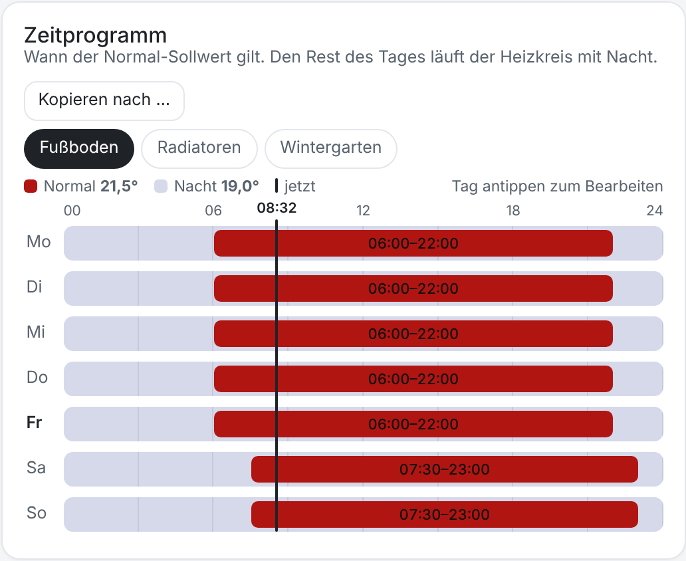

Wochenraster je Heizkreis: wann der Normal-Sollwert gilt, den Rest des Tages läuft der Heizkreis mit Nacht.
Tag antippen zum Bearbeiten, Ränder ziehen oder Zeiten eintippen; **Kopieren nach …** überträgt einen Tag auf
andere. Beim Übernehmen schreibt das Plugin nur die Schaltpunkte, die sich wirklich geändert haben.

### Heizkurve

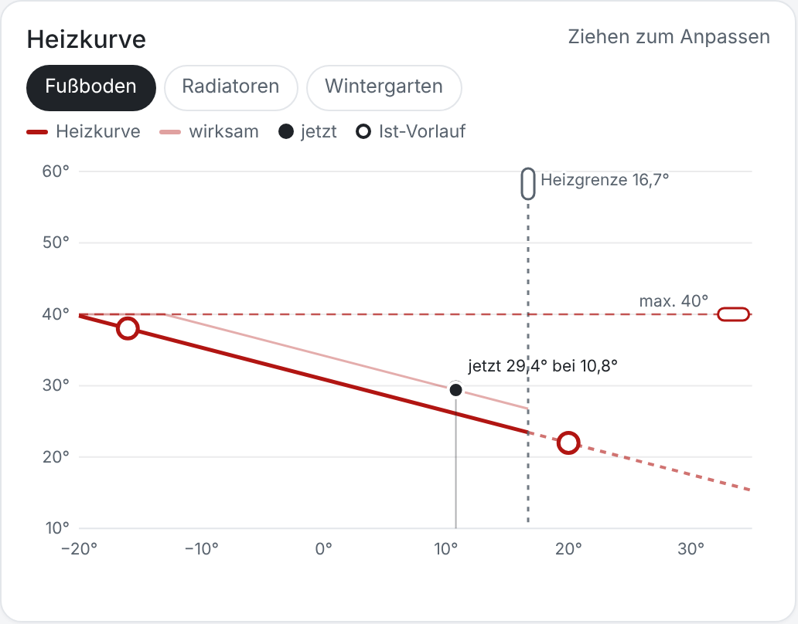

Heizkurve je Heizkreis mit dem aktuellen Arbeitspunkt (●) und dem Ist-Vorlauf (○). Kurvenpunkte, Heizgrenze und
maximale Vorlauftemperatur lassen sich mit Maus, Finger oder Pfeiltasten ziehen. Geschrieben wird erst beim
**Übernehmen**.

### Letzte 24 h

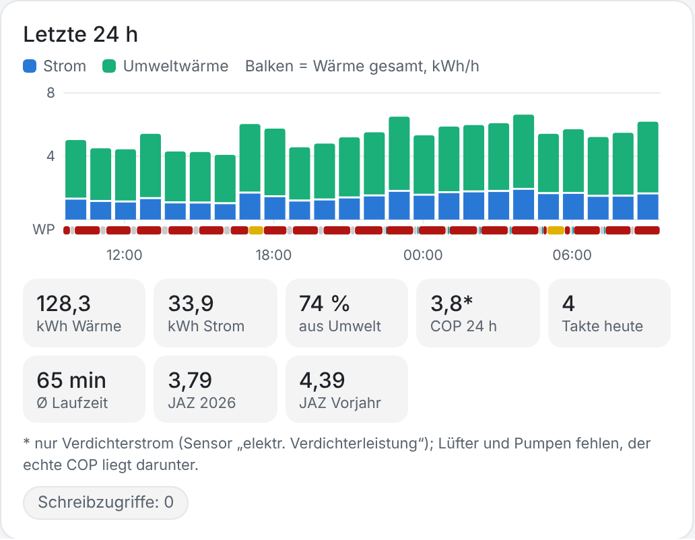

Wärme und Strom je Stunde (Balken), darunter der Betriebszustand als Band. Kennzahlen: Wärme und Strom in kWh,
Anteil Umweltwärme, COP der letzten 24 h, Takte heute, mittlere Laufzeit, Jahresarbeitszahl laufendes und letztes
Jahr. Den Verlauf zeichnet der Dienst selbst auf und hält 48 Stunden vor; nach der Installation füllt sich die
Karte nach und nach („Aufzeichnung seit …“).

### Details und Darstellung

Ein Klick auf einen Heizkreis oder einen Wert öffnet einen Dialog mit allen Angaben und dem Verlauf der letzten
24 Stunden. Die App passt sich an Desktop, Tablet und Handy an:

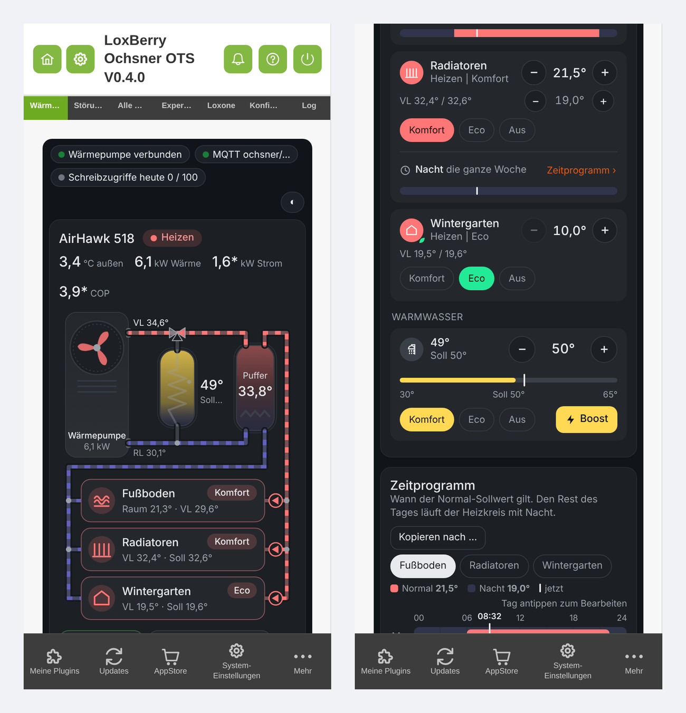

## Störungen

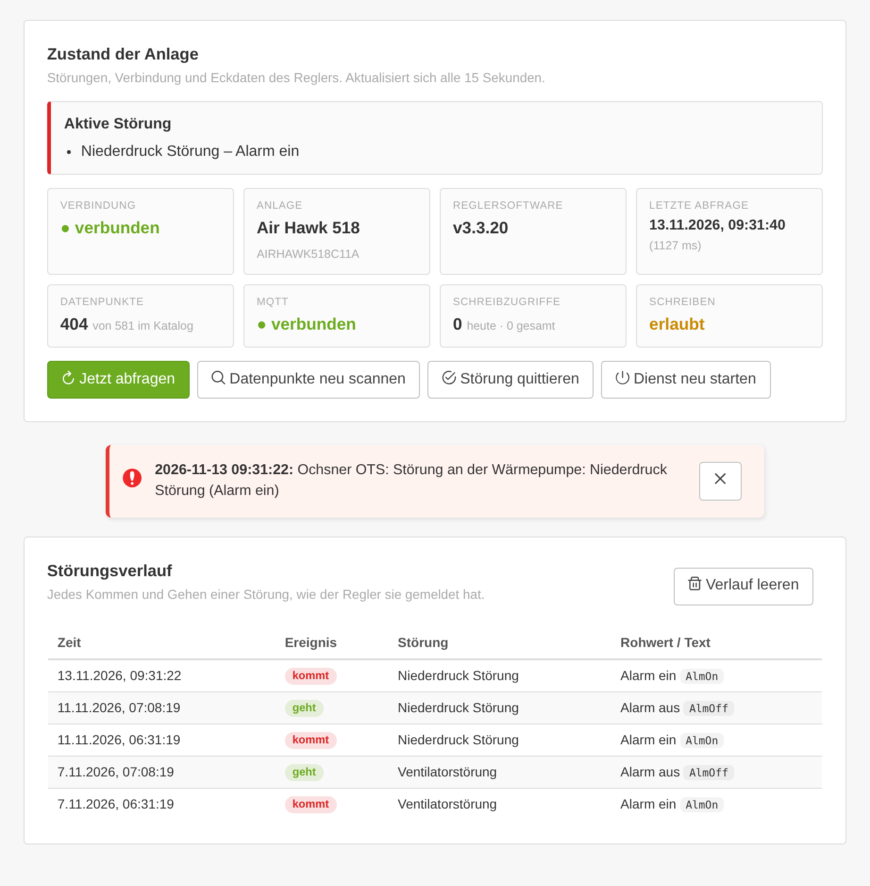

Zustand der Anlage auf einen Blick: aktive Störungen, Verbindung, Anlagentyp und Reglersoftware, letzte Abfrage,
Anzahl der Datenpunkte, MQTT und Schreibzugriffe. Darunter die **LoxBerry-Benachrichtigungen** des Plugins und der
**Störungsverlauf** – jedes Kommen und Gehen einer Störung, so wie der Regler sie gemeldet hat.

Schaltflächen: *Jetzt abfragen*, *Datenpunkte neu scannen* (z. B. nach einem Software-Update des Reglers),
*Störung quittieren* (nur bei erlaubtem Schreiben und wenn der Regler das anbietet), *Dienst neu starten*.

## Alle Werte

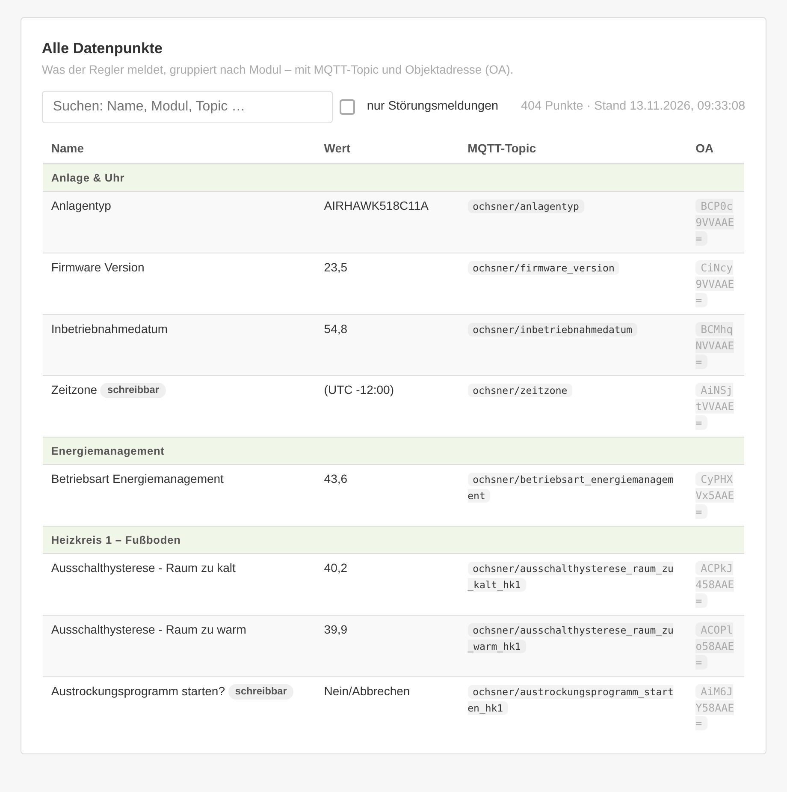

Alle Datenpunkte, die der Regler liefert (bei einer Air Hawk rund 400), gruppiert nach Modul – mit MQTT-Topic und
Objektadresse (OA). Suchfeld und Filter „nur Störungsmeldungen“.

## Experten-Editor

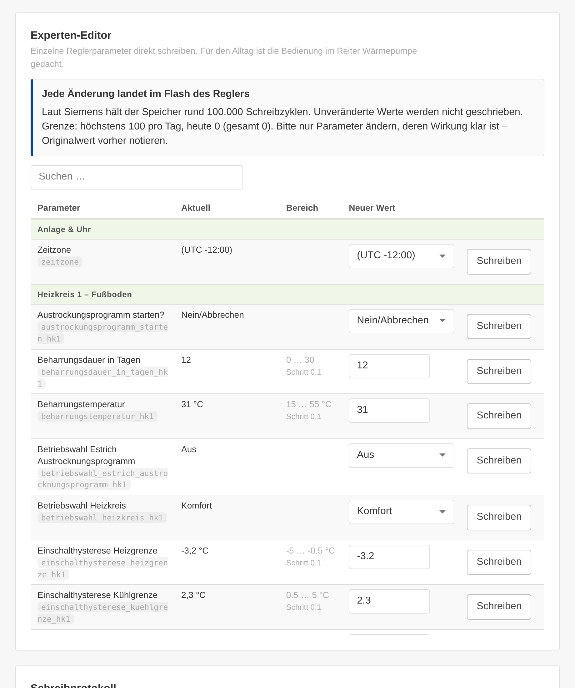

Einzelne schreibbare Reglerparameter mit aktuellem Wert, erlaubtem Bereich und Schrittweite. Jede Änderung
muss bestätigt werden. Darunter das **Schreibprotokoll** aller Schreibzugriffe aus App, Loxone und Editor.

> [!CAUTION]
> Nur Parameter ändern, deren Wirkung klar ist, und den Originalwert vorher notieren. Jede Änderung landet im
> Flash-Speicher des Reglers.

## Loxone

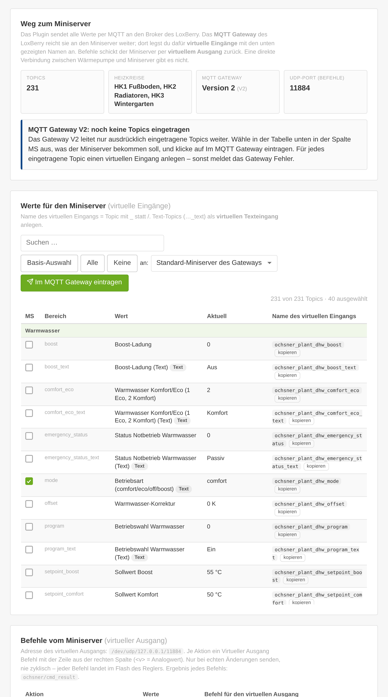

Alles für die Anbindung an den Miniserver: welches MQTT Gateway läuft, alle Topics mit dem fertigen Namen des
virtuellen Eingangs (zum Kopieren) und dem aktuellen Wert, und alle Befehle für virtuelle Ausgänge. Mit Gateway V2
wählst du hier aus, welche Topics der Miniserver bekommt. Ausführlich: [Loxone-Anbindung](loxone.md).

## Konfiguration

Alle Einstellungen mit Standardwerten: siehe [Installation → Ersteinrichtung](installation.md#ersteinrichtung).
Eingaben prüft die LoxBerry-Formularvalidierung schon beim Tippen. Der **Diagnose-Export** lädt eine JSON-Datei für
die Fehlersuche herunter – ohne Passwort, PIN, Benutzer und Seriennummer, mit gekürzter IP.

## Log

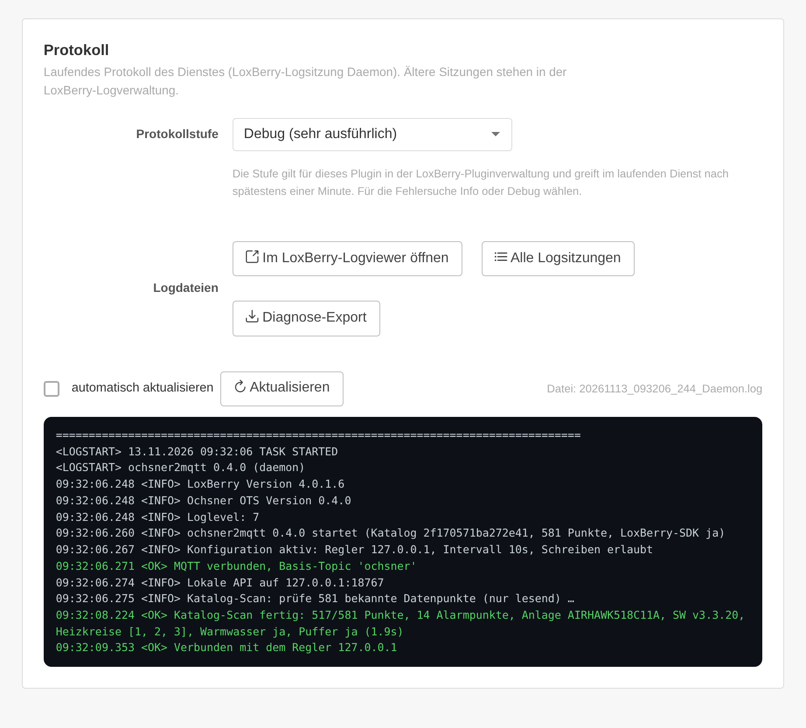

Laufendes Protokoll des Dienstes, farbig nach `<ERROR>`, `<WARNING>` und `<OK>`, auf Wunsch automatisch
aktualisiert. Die **Protokollstufe** (Fehler, Warnungen, Info, Debug) gilt für das Plugin in der
LoxBerry-Plugin-Verwaltung und greift im laufenden Dienst nach spätestens einer Minute. Links öffnen die Datei im
LoxBerry-Logviewer und alle Log-Sitzungen im Log Manager.

> [!TIP]
> Neu installierte Plugins protokollieren bei LoxBerry nur Fehler. Für die Fehlersuche die Stufe auf **Info** oder
> **Debug** stellen.
