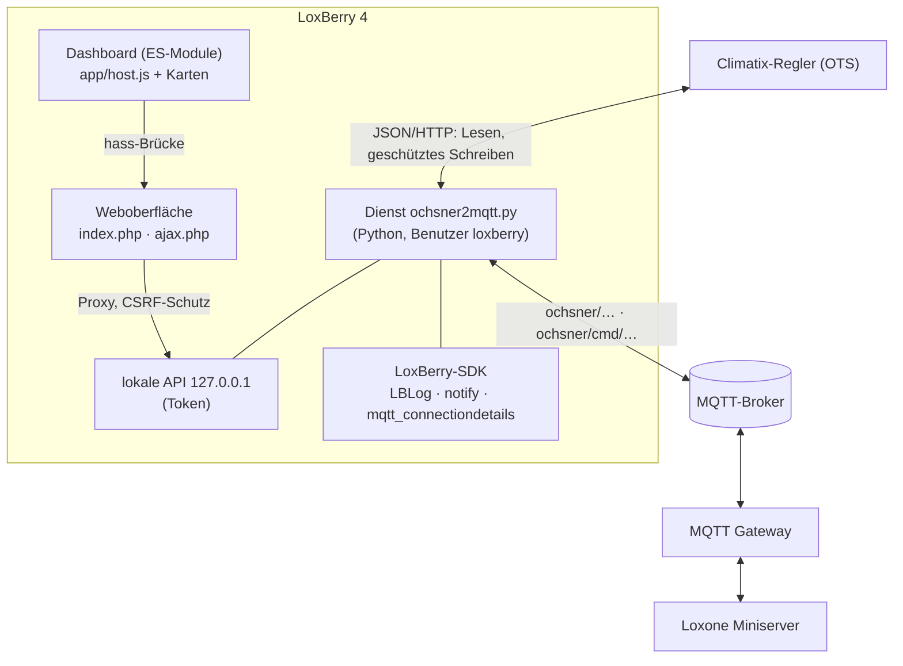

# Entwicklung

[← Übersicht](../README.md) · [Installation](installation.md) · [Bedienung](bedienung.md) · [Loxone](loxone.md) · [MQTT-Referenz](mqtt-referenz.md) · [Sicherheit](sicherheit.md) · [Fehlersuche](fehlersuche.md) · **Entwicklung**

---

## Inhalt
- [Aufbau](#aufbau)
- [Verzeichnisse](#verzeichnisse)
- [LoxBerry-Vorgaben](#loxberry-vorgaben)
- [Tests](#tests)
- [Screenshots und MQTT-Referenz neu erzeugen](#screenshots-und-mqtt-referenz-neu-erzeugen)
- [Release](#release)
- [Herkunft und Lizenzen](#herkunft-und-lizenzen)

## Aufbau



- **Dienst** (`bin/ochsner2mqtt.py`): Katalog-Scan, zyklisches Lesen, Interpretation (Enums, Störungen),
  Anlagenrollen (`bin/ots/engine.py`), MQTT, lokale API (`bin/ots/api.py`), Schreibschutz, Verlauf.
- **LoxBerry-Anbindung** (`bin/ots/lbsdk.py`): Protokoll über `LBLog`, Benachrichtigungen, MQTT-Zugang,
  Sprachtexte – mit Rückfallwegen, wenn das SDK fehlt (Tests).
- **Weboberfläche** (`webfrontend/htmlauth/`): `index.php` (LoxBerry-Kopf, Navigation, Templates),
  `ajax.php` (JSON-Endpunkt, CSRF-Schutz), `js/o2m.js` und `css/o2m.css` (Plugin-Seiten),
  `app/` (Dashboard aus der HA-Integration, `host.js` stellt ein `hass`-Objekt bereit).
- **Templates** (`templates/`): `page.html`, `app.html`, Hilfe, Sprachdateien.

## Verzeichnisse

| Pfad | Inhalt |
|---|---|
| `plugin.cfg` | LoxBerry-Plugin-Beschreibung (Interface 2.0) |
| `preinstall.sh` · `postinstall.sh` · `preupgrade.sh` · `postupgrade.sh` · `postroot.sh` | Installationsschritte |
| `uninstall/uninstall.sh` | Aufräumen bei der Deinstallation |
| `daemon/daemon.sh` · `cron/crontab` | Start beim Booten, Watchdog |
| `bin/` | Dienst, `ctl.sh`, `healthcheck`, Katalog |
| `config/` | Standardkonfiguration, Abo für MQTT Gateway V1 |
| `templates/lang/` | `language_de.ini` / `language_en.ini`, `help_de.ini` / `help_en.ini` |
| `icons/` | `icon.svg` und PNG 64/128/256/512 |
| `tests/` | Testsuiten, Regler-Simulation, simulierter LoxBerry, Doku-Werkzeuge |
| `tools/build-release.sh` | Baut das Installations-ZIP |
| `docs/` | Dokumentation und Screenshots |

## LoxBerry-Vorgaben

Umgesetzt nach dem [LoxBerry-Entwickler-Wiki](https://wiki.loxberry.de/entwickler/start):

| Vorgabe | Umsetzung |
|---|---|
| Plugin-Interface 2.0, `plugin.cfg` | Autor (bestimmt die Plugin-ID), Version SemVer, `LB_MINIMUM=4.0.1`, `CUSTOM_LOGLEVELS=true`, AutoUpdate |
| Installationsskripte | Argumente `$1…$6`, Tags `<OK>`/`<INFO>`/`<WARNING>`/`<FAIL>`, Exit-Codes (preinstall `2` bricht ab) |
| Keine festen Pfade | nur SDK-Variablen bzw. `REPLACELBPBINDIR`; Pfade aus dem eigenen Speicherort |
| Logging | `loxberry.log.LBLog` (Sitzung „Daemon“, LOGSTART/LOGEND, Stufe aus der Plugin-Datenbank) |
| Benachrichtigungen | `loxberry.log.notify` (Paket = Plugin-Ordner), Zähler im Menü über `Notify_Package` |
| MQTT | `loxberry.io.mqtt_connectiondetails` (TLS), Gateway V1 `mqtt_subscriptions.cfg`, V2 `subscriptions.json` |
| Weboberfläche | Design System ohne jQuery Mobile (`nojqm`), `$htmlhead`, `$navbar`, `LBTemplate`, Formularvalidierung `validate.js` |
| Mehrsprachigkeit | `LBSystem::readlanguage`, Rückfall Englisch, mehrsprachige Hilfe `templates/help` |
| Healthcheck | `bin/healthcheck`, JSON, Englisch, Status 3–6, Detail-Logdatei im Plugin-Logordner |
| Daemon/Cron | `daemon/daemon.sh` (Boot), `cron/crontab` (Watchdog) |
| Deinstallation | entfernt eigene Spuren außerhalb der Plugin-Ordner |
| Dateien | LF, UTF-8 ohne BOM, Icons SVG + PNG |

Hinweis: `LBWeb::loglevel_select_html()` lässt sich mit PHP 8 nicht aufrufen (nicht statisch, nutzt eine
undefinierte Konstante). Das Plugin bildet die Auswahl deshalb nach und nutzt denselben Endpunkt
(`ajax-config-handler.cgi`, Aktion `plugin-loglevel`).

## Tests

```bash
tests/run_all.sh                                   # Stubs, ohne LoxBerry-Quellcode
LBSRC=/pfad/zu/Loxberry tests/run_all.sh           # simulierter LoxBerry 4 mit echten SDKs
```

| Suite | Prüft |
|---|---|
| 1 `run_tests.sh` / `e2e_test.py` | Dienst ohne SDK: MQTT, Störungen, Grenzen, Ratenlimit, Retained-Schutz, Auth-Fehler, Logformat |
| 2 `api_test.py` | App-API, Zeitprogramm (genau ein Schreibzugriff), Tageslimit, Loxone-Befehle |
| 3 `ui_test.py` | Browser: Bedienung der App, Zusammenfassen von Klicks, Sperre, dunkles Handy-Layout |
| 4 `v03_test.py` | Puffer-Erkennung, Diagnose ohne Zugangsdaten, MQTT Gateway V2 |
| 5 `ui_v03_test.py` | Browser: Schema (geschlossene Kreise, synchrone Animation), Formular-Ausrichtung, Loxone-Seite |
| 6 `v04_test.py` | LoxBerry-Vorgaben: plugin.cfg, Sprachdateien, LBLog, Benachrichtigungen, Protokollstufe, Healthcheck, Migration, Deinstallation, PHP-8-Warnungen |

**Simulierter LoxBerry** (`tests/dev_env.sh` mit `LBSRC`): Das Plugin wird wie vom Installer in einen
LoxBerry-Verzeichnisbaum kopiert und läuft dort mit `libs/phplib` und `libs/pythonlib` des LoxBerry, echtem Kopf,
echter Navigation und echtem CSS, als Benutzer *loxberry* über `ctl.sh`. `tests/lbsim/router.php` bildet die
wenigen Perl-CGIs nach (Benachrichtigungen, Protokollstufe). Die Regler-Simulation `tests/mock_climatix.py` kennt
die Profile `518` (drei Heizkreise, Puffer), `208` und `208buf` sowie die Zustände `heat`, `dhw`, `defrost`, `standby`.

Voraussetzungen: Python 3.9+, `paho-mqtt`, `mosquitto`, PHP 8 mit `pdo_sqlite`, für die Browser-Tests Playwright
mit Chrome, für den simulierten LoxBerry ein Benutzer `loxberry`. Die CI (GitHub Actions) führt Lint und die
Suiten 1, 2, 4 und 6 aus und baut das Installations-ZIP.

Entwicklungsumgebung von Hand: `tests/dev_env.sh start` → Weboberfläche unter `http://127.0.0.1:18090/`.

## Screenshots und MQTT-Referenz neu erzeugen

```bash
O2M_SEED=1 LBSRC=/pfad/zu/Loxberry tests/dev_env.sh start
python3 tests/docs/screenshots.py docs/screenshots all
python3 tests/docs/mqtt_reference.py docs/mqtt-referenz.md
tests/dev_env.sh stop
O2M_SEED=1 LBSRC=/pfad/zu/Loxberry ALARM_AFTER=4 tests/dev_env.sh start
python3 tests/docs/screenshots.py docs/screenshots alarm      # Störungsseite mit aktiver Störung
```

`O2M_SEED=1` legt einen plausiblen 24-h-Verlauf und einen kleinen Störungsverlauf an (`tests/docs/seed_history.py`).
Das Banner entsteht aus `tests/docs/banner.html`.

## Release

1. Version in `plugin.cfg` (`VERSION`) und `bin/ochsner2mqtt.py` (`VERSION`) erhöhen, `CHANGELOG.md` ergänzen.
2. Tests laufen lassen, mergen.
3. Tag setzen – entweder `git tag v0.4.1 && git push origin v0.4.1` oder auf GitHub unter
   *Releases → Draft a new release* mit neuem Tag `v0.4.1` veröffentlichen. Der Workflow **Release** baut
   `LoxBerry-Plugin-ochsner2mqtt-0.4.1.zip`, hängt es an das Release und setzt Titel und Notizen aus dem CHANGELOG.
4. Danach `release.cfg` (bzw. für Vorabversionen wie `0.5.0-beta.1` die `prerelease.cfg`) auf `main` anpassen:
   `VERSION` und `ARCHIVEURL`. Erst dann melden die LoxBerrys das Update.

Lokal bauen: `tools/build-release.sh` → `dist/`.

> [!IMPORTANT]
> `[AUTHOR]` sowie `NAME`/`FOLDER` in `plugin.cfg` nie ändern – daraus bildet LoxBerry die Plugin-ID.
> Übernimmt jemand die Pflege, trägt er sich unter `[MAINTAINER]` ein.

## Herkunft und Lizenzen

- Katalog der Datenpunkte, Anlagenrollen, Schreibsequenzen und das Dashboard stammen aus
  [permissionBRICK/OTS-HomeAssistant](https://github.com/permissionBRICK/OTS-HomeAssistant) (MIT, Commit `17a787e`).
  Änderungen an übernommenen Dateien sind mit `o2m:` markiert. Lizenztexte:
  `bin/data/LICENSE-OTS-HomeAssistant.txt`, `webfrontend/htmlauth/app/LICENSE-OTS-HomeAssistant.txt`.
- Alles andere: MIT, siehe [LICENSE](../LICENSE).
