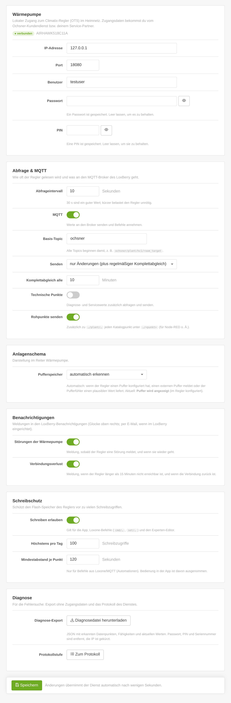

# Installation und Einrichtung

[← Übersicht](../README.md) · **Installation** · [Bedienung](bedienung.md) · [Loxone](loxone.md) · [MQTT-Referenz](mqtt-referenz.md) · [Sicherheit](sicherheit.md) · [Fehlersuche](fehlersuche.md) · [Entwicklung](entwicklung.md)

---

## Inhalt
- [Voraussetzungen](#voraussetzungen)
- [Installieren](#installieren)
- [Ersteinrichtung](#ersteinrichtung)
- [Bedienung freischalten](#bedienung-freischalten)
- [Updates](#updates)
- [Umstieg von Version 0.3](#umstieg-von-version-03)
- [Deinstallieren](#deinstallieren)
- [Was wo liegt](#was-wo-liegt)

## Voraussetzungen

| | |
|---|---|
| **LoxBerry** | ab 4.0.1 (Debian 11, 12 oder 13; Python ab 3.9, PHP ab 7.4) |
| **MQTT** | LoxBerry-Plugin *MQTT Gateway* eingerichtet – V1 (klassisch) oder V2 |
| **Wärmepumpe** | Ochsner mit OTS-Regelung (Siemens Climatix), im selben Netz wie der LoxBerry erreichbar |
| **Zugang zum Regler** | IP-Adresse sowie Benutzer, Passwort und PIN der lokalen Regler-Schnittstelle |
| **Loxone** | Miniserver, der im LoxBerry eingetragen ist (nur für die Weitergabe an Loxone nötig) |

> [!NOTE]
> Die Zugangsdaten der lokalen Regler-Schnittstelle bekommst du vom **Ochsner-Kundendienst** bzw. deinem
> **Service-Partner**. Das Plugin bringt keine Standard-Zugangsdaten mit und probiert auch keine aus.

Getestet ist das Plugin an einer **Air Hawk 208** und in einer Simulation einer **Air Hawk 518** mit drei
Heizkreisen, Warmwasser und Puffer. Der Datenpunkt-Katalog stammt aus der Home-Assistant-Integration
[OTS-HomeAssistant](https://github.com/permissionBRICK/OTS-HomeAssistant) und deckt weitere OTS-Anlagen ab.
Rückmeldungen zu anderen Modellen sind willkommen.

## Installieren

1. Das Installations-ZIP `LoxBerry-Plugin-ochsner2mqtt-<version>.zip` von der
   [Release-Seite](https://github.com/cr0ssn0tice/LoxBerry-Plugin-ochsner2mqtt/releases/latest) herunterladen.
   (Nicht „Source code“ – das ist der Quellcode mit Tests.)
2. LoxBerry → **Plugin-Verwaltung** → *Plugin installieren* → ZIP auswählen → *Installieren*.
3. Die Installation richtet den Dienst ein, startet ihn und meldet im Installationslog
   `<OK> Dienst ochsner2mqtt läuft`. Fehlt die Python-MQTT-Bibliothek, installiert das Plugin sie nach.

Danach erscheint **Ochsner OTS** unter *Meine Plugins*.

## Ersteinrichtung

Reiter **Konfiguration**:

| Bereich | Einstellung | Standard | Hinweis |
|---|---|---|---|
| Wärmepumpe | IP-Adresse, Port | –, 80 | Feste IP für den Regler im Router vergeben |
| | Benutzer, Passwort, PIN | – | Werden nur auf dem LoxBerry gespeichert (Datei-Rechte 0640) und nie an den Browser gegeben |
| Abfrage & MQTT | Abfrageintervall | 30 s | 10 s bis 1 h; kürzer belastet den Regler unnötig |
| | MQTT | an | Werte an den Broker senden, Befehle annehmen |
| | Basis-Topic | `ochsner` | Anfang aller Topics |
| | Senden | nur Änderungen | plus Komplettabgleich alle 10 min; alternativ „bei jeder Abfrage alles“ |
| | Technische Punkte | aus | Diagnose- und Servicewerte zusätzlich |
| | Rohpunkte senden | an | Jeder Katalogpunkt zusätzlich unter `ochsner/<punkt>` |
| Anlagenschema | Pufferspeicher | automatisch | oder „immer anzeigen“ / „nie anzeigen“ |
| Benachrichtigungen | Störungen der Wärmepumpe | an | LoxBerry-Benachrichtigung bei kommender und gehender Störung |
| | Verbindungsverlust | an | nach 15 Minuten ohne Verbindung, und wenn sie zurück ist |
| Schreibschutz | Schreiben erlauben | **aus** | siehe unten |
| | Höchstens pro Tag | 100 | Schreibzugriffe auf den Regler |
| | Mindestabstand je Punkt | 120 s | nur für Befehle aus Loxone/MQTT |

Nach dem Speichern übernimmt der Dienst die Einstellungen nach wenigen Sekunden – ohne Neustart. Die Kopfzeile
der Karte *Wärmepumpe* zeigt dann **verbunden** und das Anlagenmodell. Beim ersten Kontakt prüft das Plugin
einmalig rund 580 bekannte Datenpunkte (nur lesend, wenige Sekunden) und merkt sich, welche deine Anlage hat.

## Bedienung freischalten

Ab Werk liest das Plugin nur. Damit die App, Loxone-Befehle und der Experten-Editor Werte schreiben dürfen,
unter **Konfiguration → Schreibschutz** „Schreiben erlauben“ einschalten. Warum es diese Sperre gibt und welche
Grenzen zusätzlich gelten, steht unter [Sicherheit](sicherheit.md).

## Updates

- **Automatisch:** LoxBerry prüft regelmäßig die `release.cfg` dieses Repositorys. Neue Installationen
  übernehmen Releases automatisch; in der **Plugin-Verwaltung** lässt sich das je Plugin auf „nur benachrichtigen“
  oder „aus“ stellen.
- **Von Hand:** neues ZIP wie oben installieren.

Konfiguration, Zugangsdaten, Verlauf und Protokolle bleiben bei jedem Update erhalten.

## Umstieg von Version 0.3

Ab 0.4.0 steht ein neuer Autor in `plugin.cfg`. Damit hat das Plugin eine neue Plugin-ID, und LoxBerry würde es
sonst als *zweites* Plugin neben der alten Version installieren. Das fängt das Plugin ab:

1. **0.4.0 installieren.** Die Installation bricht mit einem Hinweis ab. Vorher sichert sie Konfiguration
   (inkl. Zugangsdaten), Verlauf, Störungs- und Schreibprotokoll – nur für den Benutzer *loxberry* lesbar.
2. **Alte Version deinstallieren** (Plugin-Verwaltung → „Ochsner OTS“ → Deinstallieren).
3. **0.4.0 erneut installieren.** Die Sicherung wird zurückgespielt und danach gelöscht
   (`<OK> Einstellungen und Verlauf der Vorversion übernommen`).
4. Mit MQTT Gateway V2: im Reiter **Loxone** einmal „Im MQTT Gateway eintragen“ klicken. Die Abos bleiben auch
   ohne diesen Schritt erhalten, so kann die Deinstallation sie später aber wieder entfernen.

Alle weiteren Updates laufen normal.

## Deinstallieren

Plugin-Verwaltung → *Ochsner OTS* → Deinstallieren. Das Plugin räumt auf, was es außerhalb seiner Ordner
verändert hat:

- Dienst stoppen,
- die gespeicherten (retained) MQTT-Werte unter dem Basis-Topic am Broker löschen,
- die vom Plugin eingetragenen Abos aus der Liste des MQTT Gateway V2 entfernen – fremde Abos bleiben.

Konfiguration, Daten, Protokolle und Benachrichtigungen des Plugins entfernt LoxBerry selbst.

## Was wo liegt

| Pfad (unter dem LoxBerry-Verzeichnis) | Inhalt |
|---|---|
| `config/plugins/ochsner2mqtt/ochsner2mqtt.json` | Konfiguration inkl. Zugangsdaten (0640) |
| `config/plugins/ochsner2mqtt/mqtt_subscriptions.cfg` | Abo für MQTT Gateway V1 (`<basis>/#`) |
| `data/plugins/ochsner2mqtt/` | Scan, Zustand, 48-h-Verlauf, Störungs- und Schreibprotokoll, Flash-Zähler, API-Token |
| `log/plugins/ochsner2mqtt/<zeit>_Daemon.log` | Protokoll des Dienstes (LoxBerry Log Manager) |
| `log/plugins/ochsner2mqtt/healthcheck.log` | Details des letzten Healthchecks |
| `bin/plugins/ochsner2mqtt/ctl.sh` | `start` · `stop` · `restart` · `status` |

Ein Watchdog (Cron, alle 5 Minuten) startet den Dienst neu, falls er nicht läuft; beim Booten startet ihn
LoxBerry automatisch.
