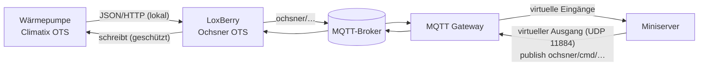
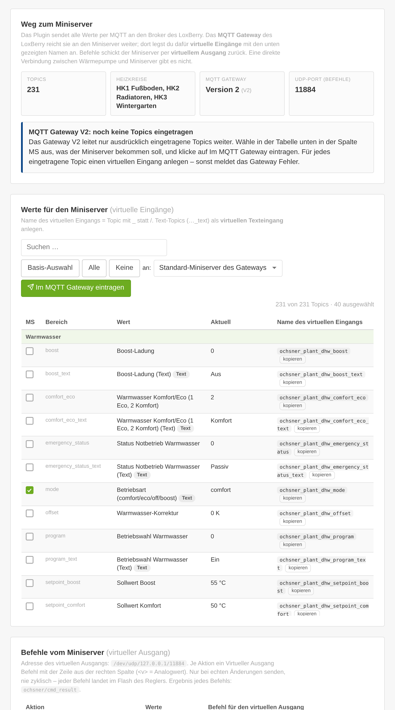

# Loxone-Anbindung

[← Übersicht](../README.md) · [Installation](installation.md) · [Bedienung](bedienung.md) · **Loxone** · [MQTT-Referenz](mqtt-referenz.md) · [Sicherheit](sicherheit.md) · [Fehlersuche](fehlersuche.md) · [Entwicklung](entwicklung.md)

---

## Inhalt
- [So kommen die Werte zum Miniserver](#so-kommen-die-werte-zum-miniserver)
- [MQTT Gateway V1 oder V2](#mqtt-gateway-v1-oder-v2)
- [Werte im Miniserver: virtuelle Eingänge](#werte-im-miniserver-virtuelle-eingänge)
- [Befehle vom Miniserver: virtueller Ausgang](#befehle-vom-miniserver-virtueller-ausgang)
- [Beispiele](#beispiele)
- [Regeln für Automationen](#regeln-für-automationen)
- [Ohne Loxone: Node-RED, Home Assistant & Co.](#ohne-loxone-node-red-home-assistant--co)

## So kommen die Werte zum Miniserver

Zwischen Wärmepumpe und Miniserver gibt es keine direkte Verbindung. Das Plugin liest den Regler, schickt alle
Werte an den MQTT-Broker des LoxBerry, und das **MQTT Gateway** des LoxBerry reicht sie an den Miniserver weiter.
Befehle gehen den umgekehrten Weg.

Der Reiter **Loxone** im Plugin zeigt alles, was du dafür brauchst – mit Kopier-Schaltflächen:

## MQTT Gateway V1 oder V2

Das Plugin erkennt, welches Gateway läuft.

| | **V1 (klassisch)** | **V2** |
|---|---|---|
| Welche Topics gehen an den Miniserver? | alle unter `ochsner/#` | nur ausdrücklich eingetragene |
| Was musst du tun? | nichts – das Plugin bringt sein Abo mit (`mqtt_subscriptions.cfg`, folgt dem Basis-Topic) | im Reiter **Loxone** Topics auswählen und **Im MQTT Gateway eintragen** |
| Mehrere Miniserver | Einstellung im Gateway | im Reiter **Loxone** wählbar: Standard-Miniserver des Gateways oder ein bestimmter |

Bei **V2** schlägt die **Basis-Auswahl** die wichtigsten Werte vor:

- Wärmepumpe: Status (Text), Außentemperatur, Vorlauf, Rücklauf, Puffer oben, Wärmeleistung, Strom, COP, Programm
- Warmwasser: Temperatur, aktiver Sollwert, Betriebsart
- je Heizkreis: Raumsoll, Raumtemperatur, Betriebsart, Preset, Vorlauf Ist/Soll, heizt/kühlt
- Plugin: `connected`, `alarm/count`, `alarm/active`, `cmd_result`

Mit **Alle** oder Häkchen in der Spalte *MS* lässt sich das beliebig erweitern. Beim Eintragen bleiben fremde Abos
unverändert, und das Plugin legt vorher eine Sicherung der Abo-Liste an.

> [!IMPORTANT]
> Für jedes eingetragene Topic einen virtuellen Eingang im Miniserver anlegen. Fehlt er, meldet das Gateway
> Fehler beim Senden.

## Werte im Miniserver: virtuelle Eingänge

Das Gateway überträgt jedes Topic an einen **virtuellen Eingang**, dessen Name das Topic ist – mit `_` statt `/`.

| Topic | Name des virtuellen Eingangs | Typ in Loxone Config |
|---|---|---|
| `ochsner/plant/hp/outdoor` | `ochsner_plant_hp_outdoor` | Virtueller Eingang (analog) |
| `ochsner/plant/hc1/room_target` | `ochsner_plant_hc1_room_target` | Virtueller Eingang (analog) |
| `ochsner/plant/hp/status_text` | `ochsner_plant_hp_status_text` | **Virtueller Texteingang** |
| `ochsner/alarm/count` | `ochsner_alarm_count` | Virtueller Eingang (analog) |
| `ochsner/alarm/active` | `ochsner_alarm_active` | **Virtueller Texteingang** |

In **Loxone Config**: *Virtuelle Eingänge* → *Virtueller Eingang* bzw. *Virtueller Texteingang* → Bezeichnung
exakt wie in der Spalte „Name des virtuellen Eingangs“ im Reiter Loxone (Kopier-Schaltfläche). Text-Topics
(`…_text`, Betriebsarten, Störungstexte) immer als Texteingang anlegen. Die vollständige Liste steht in der
[MQTT-Referenz](mqtt-referenz.md).

## Befehle vom Miniserver: virtueller Ausgang

1. *Virtuelle Ausgänge* → **Virtueller Ausgang**, Adresse `/dev/udp/<IP-des-LoxBerry>/11884`
   (der UDP-Port steht im Reiter Loxone; er kommt aus den MQTT-Gateway-Einstellungen).
2. Darunter je Aktion ein **Virtueller Ausgang Befehl**. In *Befehl bei EIN* die Zeile aus dem Reiter Loxone:

| Aktion | Befehl bei EIN | Ausgang |
|---|---|---|
| Warmwasser einmal laden | `publish ochsner/cmd/dhw/boost 1` | digital |
| Heizkreis 1 auf Eco | `publish ochsner/cmd/hc1/preset eco` | digital |
| Heizkreis 1 auf Komfort | `publish ochsner/cmd/hc1/preset comfort` | digital |
| Raumsoll Heizkreis 1 setzen | `publish ochsner/cmd/hc1/room_target <v>` | **analog** („Als Digitalausgang verwenden“ aus) |
| Warmwasser-Soll setzen | `publish ochsner/cmd/dhw/target <v>` | analog |
| Wärmepumpe abschalten / Automatik | `publish ochsner/cmd/hp/program off` · `… auto` | digital |

`<v>` ersetzt Loxone durch den Analogwert. Alle Befehle mit Wertebereichen: [MQTT-Referenz → Befehle](mqtt-referenz.md#befehle).

**Rückmeldung:** Das Ergebnis jedes Befehls kommt als JSON unter `ochsner/cmd_result` zurück
(`{"ok": true, "message": "Ausgeführt (1 Schreibzugriff)", …}`) – als Texteingang anlegen, wenn du es in Loxone
sehen willst.

## Beispiele

**Störung auf das Handy:** Virtuellen Eingang `ochsner_alarm_count` an einen *Statusbaustein* oder eine
*Benachrichtigung* hängen (Bedingung `> 0`), den Text aus `ochsner_alarm_active` mitschicken. Zusätzlich meldet das
Plugin Störungen in den LoxBerry-Benachrichtigungen (per E-Mail, wenn im LoxBerry eingerichtet).

**Warmwasser mit PV-Überschuss:** Wenn der Überschuss eine Weile über z. B. 3 kW liegt, *einmal*
`publish ochsner/cmd/dhw/boost 1` senden (Flankenauswertung, nicht zyklisch). Der Regler lädt einmalig auf das
Boost-Soll.

**Raumsoll aus der Loxone-Raumregelung:** Den Sollwert über einen analogen Ausgang mit
`publish ochsner/cmd/hc1/room_target <v>` senden, aber nur bei Änderung – z. B. über einen *Analogwertänderung*-
Baustein. Das Plugin setzt das Raumsoll wie die Ochsner-App über die ±3-K-Korrektur.

**Wärmepumpe verbunden?** `ochsner_connected` (1/0) überwacht die Verbindung Plugin → Regler,
`ochsner/status` (online/offline) die Verbindung Plugin → Broker.

## Regeln für Automationen

> [!WARNING]
> Jeder Schreibzugriff landet im Flash-Speicher des Reglers. **Nie zyklisch schreiben** – nur bei echten Änderungen.

Das Plugin hilft dabei:
- Es schreibt nur, wenn sich der Wert wirklich ändert (vorher frisch gelesen).
- Für Befehle aus MQTT/Loxone gilt ein **Mindestabstand je Punkt** (Standard 120 s) und für alle Wege ein
  **Tageslimit** (Standard 100).
- Gespeicherte (retained) Befehle führt es nie aus – ein Neustart von Broker oder Plugin löst also nichts aus.
- Ohne „Schreiben erlauben“ werden alle Befehle mit Begründung in `cmd_result` abgelehnt.

## Ohne Loxone: Node-RED, Home Assistant & Co.

Die Topics sind normales MQTT. Jedes andere System, das den Broker des LoxBerry erreicht, kann sie lesen und
Befehle unter `ochsner/cmd/…` senden. Mit **Rohpunkte senden** (Standard an) gibt es zusätzlich jeden
Katalogpunkt einzeln unter `ochsner/<punkt>`.
